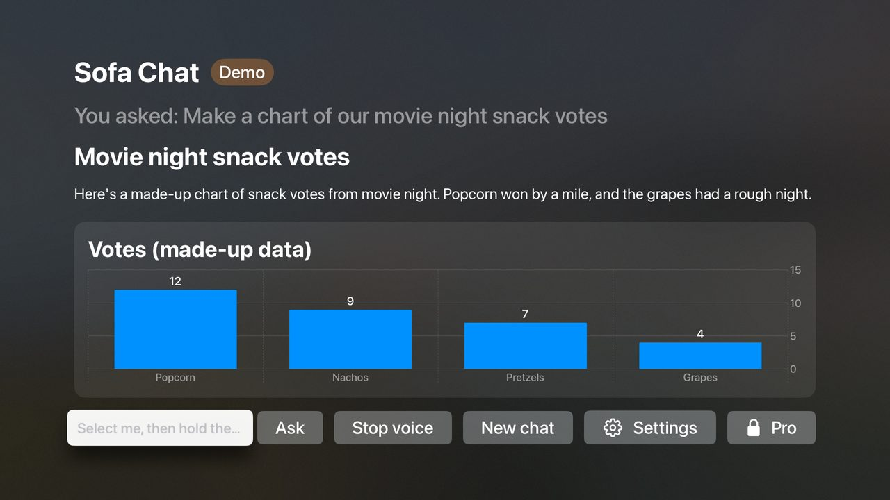
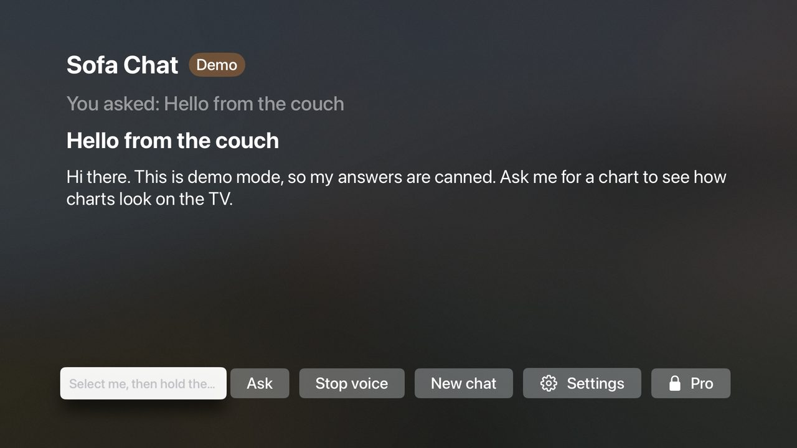
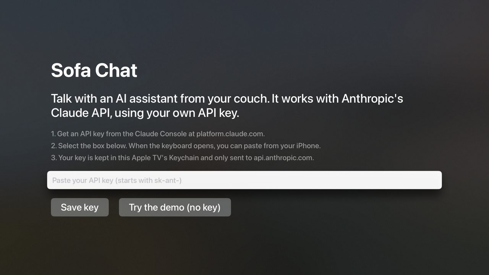
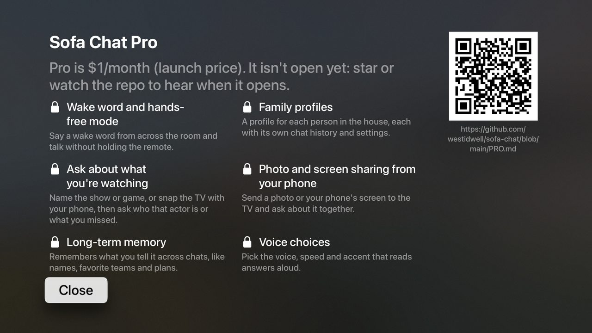

# Sofa Chat


Ask an AI assistant questions from your couch: a free Apple TV app with big, readable answers and Siri Remote dictation.

Hold the mic button on the remote, ask a question, and the answer appears in large type on the TV and is read aloud. When numbers help, you also get a simple bar chart. Sofa Chat works with Anthropic's Claude API using your own API key; there is no account to create and no server in between.

> Sofa Chat is an independent open-source project. It is not made by, affiliated with or endorsed by Anthropic.

## See it

| | |
|---|---|
|  |  |
| When numbers help, you get a simple bar chart. | Answers in large type, read aloud. |
|  |  |
| Try the demo with no key, or add your own. | Pro features are on the way. Everything else is free. |

Screenshots are from the Apple TV simulator in demo mode, with made-up answers.

## Try it (about 5 minutes)

You need a Mac with Xcode 16 or later and [XcodeGen](https://github.com/yonaskolb/XcodeGen).

```sh
brew install xcodegen
git clone https://github.com/westidwell/sofa-chat.git
cd sofa-chat
xcodegen generate
open SofaChat.xcodeproj
```

In Xcode, pick an Apple TV simulator and press Run. On the first screen:

- **Try the demo (no key)** shows the whole app with canned, made-up answers. Ask it for a chart.
- **Save key** uses the real assistant. Get an API key from the Claude Console at [platform.claude.com](https://platform.claude.com). On a real Apple TV you can paste it from your iPhone when the keyboard opens.

To run on your own Apple TV, set your team under Signing & Capabilities and change the bundle id (`com.example.sofachat`) in `project.yml`.

Run the tests (offline, no Xcode project needed, macOS or Linux with Swift 5.9 or later):

```sh
swift test --package-path SofaChatCore
```

## How it works

- **Asking.** The question box is a normal tvOS text field, so you can dictate with the remote's mic button or type with the iPhone keyboard.
- **Answering.** Each question is sent, with the chat so far, straight from the Apple TV to the Messages API at `api.anthropic.com`. The app asks for a small JSON answer: what to say, a short heading, and optional chart bars. Turn off "Headings and charts" in Settings to get plain text instead.
- **Speaking.** Answers are read aloud with the Apple TV's built-in voice. Play/Pause on the remote stops it.
- **Your key.** Entered once, stored in this Apple TV's Keychain (this device only, not synced or backed up), and only sent in the `x-api-key` header to `api.anthropic.com`. There is no key in the code and no secrets file to fill in. Remove it any time in Settings.
- **Model.** The default is `claude-sonnet-5-5` at low effort, for quick answers. You can type any model id and pick an effort level in Settings. For models that support it, a declined question can be retried on a backup model by the API (on by default, can be turned off).
- **Cost.** API usage is billed by Anthropic to your own account, per token. Sofa Chat itself is free.
- **Privacy.** No analytics, no tracking, no server of ours. The app talks to `api.anthropic.com` and nothing else.

Code layout:

| Folder | What's in it |
| --- | --- |
| `SofaChatCore/` | A Swift package with no dependencies: request building, response parsing, the conversation, key storage, demo answers and the Pro stubs. Builds on Linux too, so the tests run anywhere. |
| `App/` | The SwiftUI screens, the speech voice and the Keychain wiring. |
| `App/Assets.xcassets/` | The app icon, in three layers for the Apple TV's tilt effect, and the Top Shelf images. |
| `Design/make_artwork.py` | Draws all of that artwork in code. Change a color and run it again (needs Pillow). |
| `project.yml` | The XcodeGen spec that creates the Xcode project. |

## Free vs Pro

| Feature | Free | Pro |
| --- | :---: | :---: |
| Ask by voice with the Siri Remote | Yes | Yes |
| Big-type answers, read aloud | Yes | Yes |
| Bar charts when numbers help | Yes | Yes |
| Choose any model and effort level | Yes | Yes |
| Demo mode with no key | Yes | Yes |
| Wake word and hands-free mode | | Yes |
| Family profiles | | Yes |
| Ask about what you're watching | | Yes |
| Photo and screen sharing from your phone | | Yes |
| Long-term memory | | Yes |
| Voice choices | | Yes |

Pro is $1/month (launch price) and isn't open yet. See [PRO.md](PRO.md) for the list, and star or watch this repo to hear when it opens.

## Build on the engine

Everything that isn't a screen lives in [`SofaChatCore`](SofaChatCore), a Swift package with no dependencies: it builds the request, asks for a small structured answer (what to say, a heading, chart bars), reads it back, keeps the conversation and stores the key. If you're making a big-screen or hands-free app for a TV, a kiosk, a car screen or a headset, it does the asking and answering for you.

### Built with Sofa Chat

Built something with Sofa Chat or its engine? Post it in [Show and tell](https://github.com/westidwell/sofa-chat/discussions/categories/show-and-tell) and it can be listed here.

## Community

- **Questions and ideas**: [Discussions](https://github.com/westidwell/sofa-chat/discussions)
- **Bugs**: [open a bug report](https://github.com/westidwell/sofa-chat/issues/new/choose)
- **Contributing**: bug fixes and new free features are welcome. See [CONTRIBUTING.md](CONTRIBUTING.md).
- **Security**: report privately, see [SECURITY.md](SECURITY.md)
- Everyone here follows the [code of conduct](CODE_OF_CONDUCT.md).

If you'd like to see where Sofa Chat goes, star or watch this repo.

## License

MIT. See [LICENSE](LICENSE).
